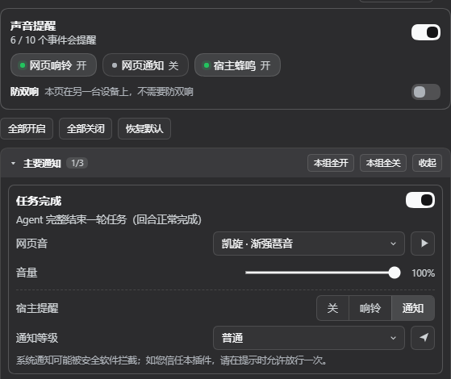
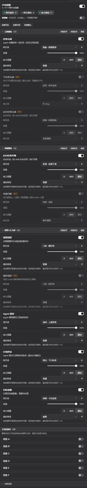

# dsh-chime-alerts · Sound alerts

**Make DeepSeek Harness (DSH) chimed when the agent is done.** A turn finishes, an approval is waiting, a plan needs review, an agent asks you something, a goal gets blocked, a background job fails — your machine plays a sound or raises a system notification instead of you watching the page.

English · [中文](README.md)

[](LICENSE)
[](https://github.com/topics/dsh-plugin)
[](CHANGELOG.md)
[](https://www.npmjs.com/package/dsh-chime-alerts)
[](#platform-support)
[](docs/TECHNICAL.md)
[](https://github.com/nienieai/dsh-chime-alerts)



*The settings page follows the DSH language setting; the screenshot above is the Chinese UI.*

## In one sentence

When something happens in DSH that you would want to know about, you get a chime in the page, a system notification, or both — and you decide per event what plays, how loud, and which events matter.

- 🔔 **Ten events**: completed turn, subagent completion, background-job completion, approval, plugin approval, agent question, plan review, goal blocked, interruption, background-job failure — each switchable on its own.
- 🎚️ **Off / beep / notify, per event.** Beep = Web Audio in the page plus a host system sound. Notify = a system notification (silent / normal / important).
- 🚪 **Keeps working with the page closed** — notifications are raised by the host process.
- 🔇 **Dedupe**: when both the page and the host are on, a given machine chimes once.
- 🌙 **Per-workspace mute**, with a small read-only marker next to the workspace title.
- 🖥️ **Cross-platform**: tested on Windows and on Linux (Ubuntu 22.04); macOS implemented, awaiting a real-machine test.
- 🈶 **Bilingual UI** (Chinese / English), following the DSH language setting.

## Why install it

| Situation | Without it | With it |
|---|---|---|
| Long agent runs | Come back and check every so often | Come back when it chimes |
| Agent waiting for approval | Stuck while you are doing something else | One sound, you switch back |
| Several sessions at once | No idea which finishes first | Each one chimes as it finishes |
| Several workspaces open | Every project rings | Mute the ones you do not care about |
| Prefer system notifications | Nothing once the page is closed | The host notifies you anyway |

## The ten events

| Event | Fires when | Default |
|---|---|---|
| Completion | The agent finishes a turn normally | 🟢 on |
| Subagent completion | A parallel subagent task finishes | ⚪ off (too frequent) |
| Background job done | A background job (e.g. shell) finishes | ⚪ off (frequent) |
| Background job failed | A background job fails | 🟢 on |
| Interruption | A run is stopped / errors / hits the token cap | ⚪ off (usually you did it) |
| Approval needed | An operation needs your manual approval | 🟢 on |
| Plugin approval | A dynamic Cordis plugin waits for you to allow a run / update | ⚪ off (overlaps approval) |
| Agent question | The agent asks you something through the question tool | 🟢 on |
| Plan review | The agent submitted a plan and waits for your OK | 🟢 on |
| Goal blocked | A long-running goal is blocked and needs you | 🟢 on |

The "Default" column is about the **browser beep** channel. **Host alerts (system sound / system notification) are off by default** — see [Why it is off by default](#why-it-is-off-by-default).

## The three channels

| Channel | Where the sound comes from | Works with page closed | Notes |
|---|---|---|---|
| Browser beep | Web Audio synthesis in the page (ten built-in chimes, or your own uploaded audio) | ❌ | Zero latency, on by default |
| Browser notification | The Web Notifications API | ❌ | Off by default, needs browser permission |
| Host beep | The host process plays a system sound (Windows `wscript` + WMP, macOS `afplay`, Linux `canberra-gtk-play`/`paplay`) | ✅ | Per-event sound choice |
| Host notification | The host raises a system notification (Windows PowerShell + WinRT toast, macOS `osascript`, Linux `notify-send`) | ✅ | Levels: silent / normal / important |

Three chips at the top of the settings page show which channels are live.

## Install

Prerequisite: DeepSeek Harness (desktop or web) with Node ≥ 22.19.

**Option 1 — from the plugins page (recommended)**

1. DSH → **Plugins** → **Add plugin**;
2. pick this repository folder (the one with `package.json`);
3. enable the plugin, refresh the page.

**Option 2 — from npm (no clone needed)**

```bash
dsh plugin --profile desktop add dsh-chime-alerts
```

Pin a version with `dsh-chime-alerts@0.6.1`. For a browser-only deployment use `--profile web` instead (same for the clone-and-link option below). Refresh the page afterwards; if the plugin still shows as disabled, flip its switch on.

**Option 3 — clone and link**

```bash
git clone https://github.com/nienieai/dsh-chime-alerts.git
dsh plugin --profile desktop add link:./dsh-chime-alerts
```

**Option 4 — dynamic install (nothing written to disk, re-paste after a DSH restart)**

Hand `dynamic/host.body.js` and `lib/client.js` to `cordis_define` (both halves must come from the same package) and activate them with `cordis_run`. See **[docs/INSTALL.md](docs/INSTALL.md)** for the detailed steps.

> Refresh the page after installing to load the UI half; host-side changes need a DSH restart.

## Why it is off by default

- **Host alerts start disabled**: installing never pops system notifications on its own. Turn on "host alerts" first, then pick beep or notify per event.
- **On Windows, notifications run PowerShell hidden** (Node cannot call WinRT directly, so PowerShell is the bridge). Some antivirus products (e.g. Huorong) treat hidden PowerShell as suspicious and prompt once — allow it, or stick to beep.
- macOS / Linux notifications do not go through PowerShell (`osascript` / `notify-send`).
- The repository ships **no prebuilt binaries**; toast scripts are generated at runtime and delete themselves, and can be reviewed line by line.

## What it looks like

Settings → **Sound alerts**: master switch and three channel chips at the top, ten event cards below (grouped as primary / other / human action needed), then per-workspace mute and diagnostics.



Each card holds the browser sound (picker + preview), volume, and the host alert mode — picking "beep" reveals the host sound and its preview, picking "notify" reveals the level and a test button. The top row also has enable-all / disable-all / restore-defaults.

## Platform support

| | Beep | System notification |
|---|---|---|
| Windows | `wscript` + WMP playing a system wav | PowerShell + WinRT toast (borrows DSH's AUMID, so the header reads "DeepSeek Harness") |
| macOS | `afplay` | `osascript` |
| Linux | `canberra-gtk-play`, falling back to `paplay` | `notify-send` |

Status: **Windows** tested locally; **Linux** tested on Ubuntu 22.04.5 (GNOME 42.9) — all sounds and all three notification levels verified, and the `question` event no longer goes silent when the freedesktop theme lacks `dialog-question.oga`; **macOS** is covered by simulated tests only.

## Privacy and security

- Reads local session state only — **no network calls, nothing uploaded**. No audio files are bundled; built-in chimes are synthesised in the browser.
- All five local endpoints (`sysget` / `sysset` / `sysbeep` / `sysnotify` / `events`) run through DSH's session check (`requestRejection`), falling back to a same-origin + loopback rule when the `connection` service is absent.
- Preview endpoints are rate limited (700 ms per event, 10 per 10 s), request bodies are capped at 64 KB, and host sounds come from an allow-list — see [SECURITY.md](SECURITY.md).
- UI settings live in browser `localStorage`; host alert settings live under `~/.dsh/plugins/dsh-chime-alerts`, shared by static and dynamic installs.

## Known limitations

- Only events visible to this DSH process are covered; with the page closed only host alerts work (and the event must not be "off").
- The **macOS branch has not been tested on a real Mac**.
- Dedupe decides "same machine" from the page address (`localhost` / `127.0.0.1`); opening the page through a tunnel from another machine looks local, so turn dedupe off in that setup.
- Latency: ≤ ~1.5 s for the dynamic build; the static build is immediate for completion events (snapshot subscription) and ≤ ~1.5 s for events needing a human (polling plus a 3 s host throttle).
- The navigation marker and workspace-mute badge depend on the shell DOM; a DSH redesign may need a small adaptation (diagnostics shows the match count).
- Depends on DSH internal event contracts (not a public API); run `npm test` after upgrading DSH.

## FAQ

**Installed but silent?**
Check two things separately: the master switch plus the per-event browser switch; and host alerts, which are off until you pick beep or notify on a card.

**Antivirus prompt on Windows?**
That is the notification channel spawning hidden PowerShell. Allow it once, or use beep instead.

**Does it still ring with the page closed?**
Yes, for events set to beep or notify — the host process plays them.

**Will I hear it twice?**
By default yes, once from the page and once from the host when both are on; enable "dedupe" at the top to hear it once per machine.

**Can I have notifications without page sounds?**
Yes — turn off the browser beep chip and set events to notify.

## Docs

| Document | Contents |
|---|---|
| [docs/INSTALL.md](docs/INSTALL.md) | Static / dynamic install, uninstall, troubleshooting |
| [docs/TECHNICAL.md](docs/TECHNICAL.md) | Architecture, event contracts, endpoints and auth, settings shape, tests and releasing |
| [docs/REGISTRIES.md](docs/REGISTRIES.md) | Market requirements and listing status |
| [docs/TODO.md](docs/TODO.md) | Open work and trade-offs |
| [CHANGELOG.md](CHANGELOG.md) | What changed in each version |
| [SECURITY.md](SECURITY.md) | Security model and reporting |

## Development

```sh
npm test       # host 187 + dynamic client 140 + static client 133 = 460 assertions (plain Node)
npm run check  # syntax check, version consistency, generated-file consistency
npm run body   # rebuild dynamic/host.body.js after editing lib/host.js
npm run chunks # rebuild .chunks/*.txt (paste frames for the dynamic install)
```

## Contributing

Issues and PRs are welcome. Run `npm run check` before submitting, and update [CHANGELOG.md](CHANGELOG.md) for user-visible changes. Release steps live in [docs/TECHNICAL.md](docs/TECHNICAL.md).

If this plugin saves you time, a ⭐ is the best thanks.

## Notes

- **How it was built**: code and documentation were produced with **AI agent tooling**; the human set direction, made the trade-offs and accepted the result.
- **Translations**: the English README and the English UI strings were translated by an AI agent; wording may be off in places. Issues and PRs welcome.
- **Screenshots**: taken from the real UI, with workspace names replaced by sample names.

This is an **unofficial community project**, not affiliated with or endorsed by DeepSeek; "DeepSeek" in the name only identifies the harness it plugs into.

## License

[MIT](LICENSE) © dsh-chime-alerts contributors
