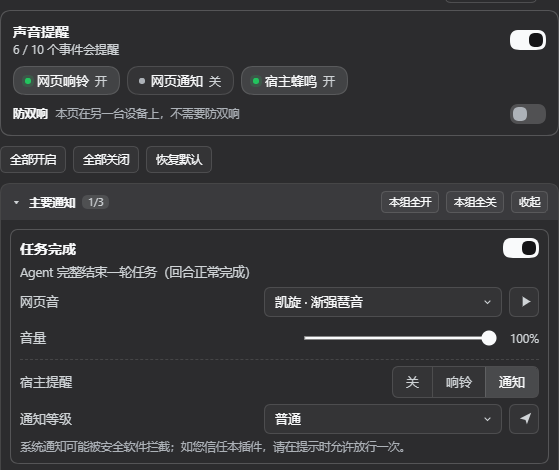
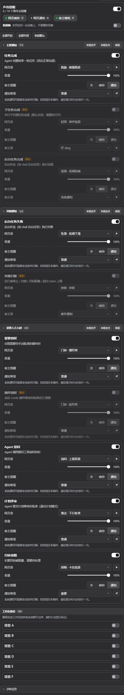

# 声音提醒 · dsh-chime-alerts

**让 DeepSeek Harness（DSH）干完活时「响一声」。** Agent 跑完一轮、等你批准、提交计划、有事问你、目标卡住、后台任务挂了——电脑响一声或弹一条系统通知，不用一直盯着页面。

[English](README.en.md) · 中文

[](LICENSE)
[](https://github.com/topics/dsh-plugin)
[](CHANGELOG.md)
[](https://www.npmjs.com/package/dsh-chime-alerts)
[](#跨平台)
[](docs/TECHNICAL.md#9-测试与生成物)
[](https://github.com/nienieai/dsh-chime-alerts)



## 一句话

装好之后，DSH 里发生「需要你知道」的事件时会提醒你：**网页里响一声**、**弹一条系统通知**，或者两者都要。响什么、多响、哪些事件响，都能在设置页里逐个调。

- 🔔 **十类事件**：任务完成、子任务完成、后台任务完成、需要授权、插件授权、Agent 提问、计划评审、目标受阻、其他打断、后台任务失败，每类独立开关。
- 🎚️ **三选一**：每个事件选「关 / 响铃 / 通知」。响铃 = 浏览器合成音 + 宿主系统音效；通知 = 系统通知中心（可设静默 / 普通 / 重要）。
- 🚪 **关掉页面也响**：「通知」由宿主进程发出，页面关了照样弹。
- 🔇 **防双响**：网页和宿主同时开着时，同一台设备只响一次。
- 🌙 **按工作区静音**：某个工作区不想被打扰，静音后侧栏标题旁会出现一个小标记。
- 🖥️ **跨平台**：Windows 本机实测、Linux（Ubuntu 22.04）实测、macOS 已实现待真机验证。
- 🈶 **中英双语**：设置页文案跟随 DSH 的语言设置。

## 为什么值得装

| 场景 | 没有它 | 装上之后 |
|---|---|---|
| 让 Agent 跑长任务 | 隔一会儿回来瞄一眼 | 听到声音再回来，中间去做别的事 |
| Agent 停下来等你批准 | 一直卡在等，你却在忙别的 | 一声提示音，切回来看 |
| 一次跑好几条会话 | 不知道哪条先完成 | 哪条先完成哪条先响，并行任务逐个提醒 |
| 开着好几个工作区 | 别人的项目也在响 | 按工作区静音，只留需要的 |
| 喜欢系统通知 | 网页关了就收不到 | 交给宿主发通知，页面关着也能弹 |

## 十类事件

| 事件 | 什么时候响 | 默认 |
|---|---|---|
| 任务完成 | Agent 完整结束一轮任务（回合正常完成） | 🟢 开 |
| 子任务完成 | 并行子代理任务完成 | ⚪ 关（太频繁，需要时打开） |
| 后台任务完成 | 后台作业（如 shell 后台任务）执行完成 | ⚪ 关（频繁） |
| 后台任务失败 | 后台作业执行失败 | 🟢 开 |
| 其他打断 | 运行被停止 / 出错 / 目标阻塞 / 超出 token 上限 | ⚪ 关（多半是你自己按的） |
| 需要授权 | 出现需要你手动批准的操作 | 🟢 开 |
| 插件授权 | 动态 Cordis 插件等待你批准运行 / 更新 | ⚪ 关（与上面重复） |
| Agent 提问 | Agent 调用提问工具询问你时 | 🟢 开 |
| 计划评审 | Agent 提交计划等待你批准（退出计划模式） | 🟢 开 |
| 目标受阻 | 长期目标被阻塞，需要你处理 | 🟢 开 |

「默认」这一列指的是**网页响铃**通道。**宿主提醒（系统音效 / 系统通知）一律默认关**——见下面[为什么默认是关的](#为什么默认是关的)。

## 三个通道

| 通道 | 声音从哪来 | 页面关掉还响吗 | 备注 |
|---|---|---|---|
| 网页响铃 | 浏览器 Web Audio 实时合成（十种内置提示音，也可上传自定义音频） | ❌ | 零延迟，默认开启 |
| 网页通知 | 浏览器 Notification API | ❌ | 默认关，需要浏览器授权 |
| 宿主提醒 · 响铃 | 宿主进程播系统音效（Windows `wscript` + WMP、macOS `afplay`、Linux `canberra-gtk-play`/`paplay`） | ✅ | 每个事件可选宿主音色 |
| 宿主提醒 · 通知 | 宿主进程弹系统通知（Windows PowerShell + WinRT toast、macOS `osascript`、Linux `notify-send`） | ✅ | 等级：静默 / 普通 / 重要 |

三者在设置页顶部是三个状态 chip，随时能看出哪条通道开着。

## 安装

前提：已经装好 **DeepSeek Harness**（桌面端或 Web 端均可），Node ≥ 22.19。

**方式一：从插件页安装（推荐）**

1. 打开 DSH → **插件** → **添加插件**；
2. 选择本仓库目录（就是含 `package.json` 的那层）；
3. 打开插件开关，刷新页面。

**方式二：从 npm（不用克隆仓库）**

```bash
dsh plugin --profile desktop add dsh-chime-alerts
```

要固定版本就写 `dsh-chime-alerts@0.6.1`。纯 Web 部署把 `--profile desktop` 换成 `--profile web`（下面 clone 的方式同理）。装完刷新页面；如果插件列表里它还是关着的，把开关打开。

**方式三：命令行 + 本地目录**

```bash
git clone https://github.com/nienieai/dsh-chime-alerts.git
dsh plugin --profile desktop add link:./dsh-chime-alerts
```

**方式四：动态安装（不落盘，重启 DSH 后需重装）**

把 `dynamic/host.body.js` 和 `lib/client.js` 全文分别交给 `cordis_define`，再用 `cordis_run` 激活。两半**必须是同一个包**，否则更新时会把另一半卸载。详细步骤与排错见 **[docs/INSTALL.md](docs/INSTALL.md)**。

> 装完要**刷新页面**让界面部分加载；宿主部分的改动需要重启 DSH 才生效。

## 为什么默认是关的

- **宿主提醒默认关**：装好不会自己弹系统通知。要用的先在设置里打开「宿主提醒」，再逐个事件选「响铃」或「通知」。
- **Windows 的系统通知会隐藏调用 PowerShell**（Node 无法直接调 WinRT，只能借它当桥）。部分杀毒软件（如「火绒」）会把「隐藏运行 PowerShell」判为可疑并弹窗，需要放行一次；介意的话就只用「响铃」，或者干脆不用宿主提醒。
- macOS / Linux 的通知不经过 PowerShell（`osascript` / `notify-send`）。
- 仓库里**没有任何预编译二进制**；toast 脚本在运行时生成、跑完自删，可以逐行审阅。

## 长什么样

设置 → **声音提醒**：顶部是总开关 + 三个通道 chip，下面是十张事件卡片（分组：主要通知 / 其他通知 / 需要人介入时），最后是工作区静音与诊断信息。



每张卡片：网页音（下拉 + 试听）、音量、宿主提醒三选一——选「响铃」才出现宿主音与试听，选「通知」才出现通知等级与测试。顶部还有「全部开启 / 全部关闭 / 恢复默认」批量操作。

## 跨平台

| | 响铃 | 系统通知 |
|---|---|---|
| Windows | `wscript` + WMP 播系统 wav | PowerShell + WinRT toast（归属借 DSH 的 AUMID，标题栏显示「DeepSeek Harness」） |
| macOS | `afplay` | `osascript` |
| Linux | `canberra-gtk-play` → 回退 `paplay` | `notify-send` |

实测情况：**Windows** 本机实测；**Linux** 在 Ubuntu 22.04.5（GNOME 42.9）实测——各音效播放、三档通知等级全部成功，并修掉了 freedesktop 主题缺 `dialog-question.oga` 时 `question` 静默无声的问题；**macOS** 只有模拟测试，尚无真机验证。

## 隐私与安全

- 只读本机会话状态，**不联网、不上传**任何内容；仓库里不含音频文件，内置提示音全部由浏览器合成。
- 插件开的 5 条本地端点（`sysget` / `sysset` / `sysbeep` / `sysnotify` / `events`）都先过 DSH 的会话鉴权（`requestRejection`），没有 `connection` 服务时退回「同源 + 回环」保守判定。
- 试听类端点限流（同事件 700ms、全局 10 次 / 10s），请求体上限 64 KB，宿主音只接受白名单值——详见 [SECURITY.md](SECURITY.md)。
- 设置存浏览器 `localStorage`；宿主提醒配置存 DSH 数据目录 `~/.dsh/plugins/dsh-chime-alerts`（Windows 为 `%USERPROFILE%\.dsh\plugins\dsh-chime-alerts`），静态与动态安装共用。

## 已知限制

- 只覆盖本 DSH 进程能观察到的事件；页面关闭时只有宿主提醒生效（且该事件不能是「关」）。
- **macOS 分支尚未真机实测**。
- 防双响的「同机」按页面地址判断（`localhost` / `127.0.0.1`）：用端口转发 / 隧道从另一台机器以 `127.0.0.1` 打开时会被误判成本机，此时请把防双响关掉。
- 延迟：动态版 ≤ ~1.5s；静态版完成类实时（快照订阅），需要人介入类 ≤ ~1.5s（轮询 + 宿主 3s 节流）。
- 导航图标、工作区静音标记依赖外壳 DOM 结构，DSH 改版可能需要适配（「诊断信息」里能看到匹配计数）。
- 依赖 DSH 内部事件契约（非公开 API），升级 DSH 后请先跑 `npm test`。

## 常见问题

**装了没声音？**
两件事分开看：① 设置页顶部总开关、以及对应事件的网页响铃开关是否打开；② 宿主提醒默认是关的，需要在卡片里显式选「响铃」或「通知」。

**Windows 上杀毒软件弹窗？**
那是「通知」通道借 PowerShell 调 WinRT 引起的（见[为什么默认是关的](#为什么默认是关的)）。放行一次即可，或者改用「响铃」。

**页面关了还会响吗？**
会——只要该事件选的是「响铃」或「通知」，声音由宿主进程发出。

**会不会重复响？**
同一事件在网页和宿主同时开着时默认会各响一次；打开顶部的「防双响」，本机就只响一次。

**设置会丢吗？**
网页部分存浏览器（换浏览器要重设），宿主部分存 `~/.dsh/plugins/dsh-chime-alerts`，静态和动态安装互相继承。

**能只用系统通知、不要网页声音吗？**
能。顶部关掉「网页响铃」，事件卡片选「通知」。

## 文档

| 文档 | 内容 |
|---|---|
| [docs/INSTALL.md](docs/INSTALL.md) | 静态 / 动态安装、卸载、排错 |
| [docs/TECHNICAL.md](docs/TECHNICAL.md) | 架构、事件契约、端点与鉴权、设置结构、测试与发版 |
| [docs/REGISTRIES.md](docs/REGISTRIES.md) | 各市场准入要求与上架状态 |
| [docs/TODO.md](docs/TODO.md) | 待办与已知取舍 |
| [CHANGELOG.md](CHANGELOG.md) | 每个版本改了什么 |
| [SECURITY.md](SECURITY.md) | 安全边界与漏洞报告 |

## 开发

```sh
npm test       # 宿主 187 + 动态客户端 140 + 静态客户端 133 = 460 项断言（Node 即可）
npm run check  # 语法检查 + 版本一致性 + 生成物一致性（dynamic/host.body.js、.chunks）
npm run body   # 改完 lib/host.js 后重建 dynamic/host.body.js
npm run chunks # 重建 .chunks/*.txt（动态安装粘贴用的分帧文本）
```

## 参与

欢迎提 Issue、提 PR。提交前请跑一遍 `npm run check`；改动用户可见行为时请同时更新 [CHANGELOG.md](CHANGELOG.md)。发版流程见 [docs/TECHNICAL.md](docs/TECHNICAL.md#10-发版流程)。

如果这个插件帮你省了时间，给个 ⭐ 就是最好的支持。

## 声明

- **开发方式**：代码与文档由 **AI Agent 工具**辅助完成，人类负责方向、取舍与验收。
- **翻译**：英文版 README 与设置页英文文案由 AI Agent 翻译，可能有用词偏差或不自然之处；发现不准确欢迎提 Issue 或 PR。
- **截图**：文档里的设置页截图取自真实界面，其中的工作区名称已替换为示例名。

本插件是**非官方社区项目**，与 DeepSeek（深度求索）没有隶属或背书关系；名称里的“DeepSeek”只用于说明它服务于 DeepSeek Harness。

## 许可证

[MIT](LICENSE) © dsh-chime-alerts contributors
